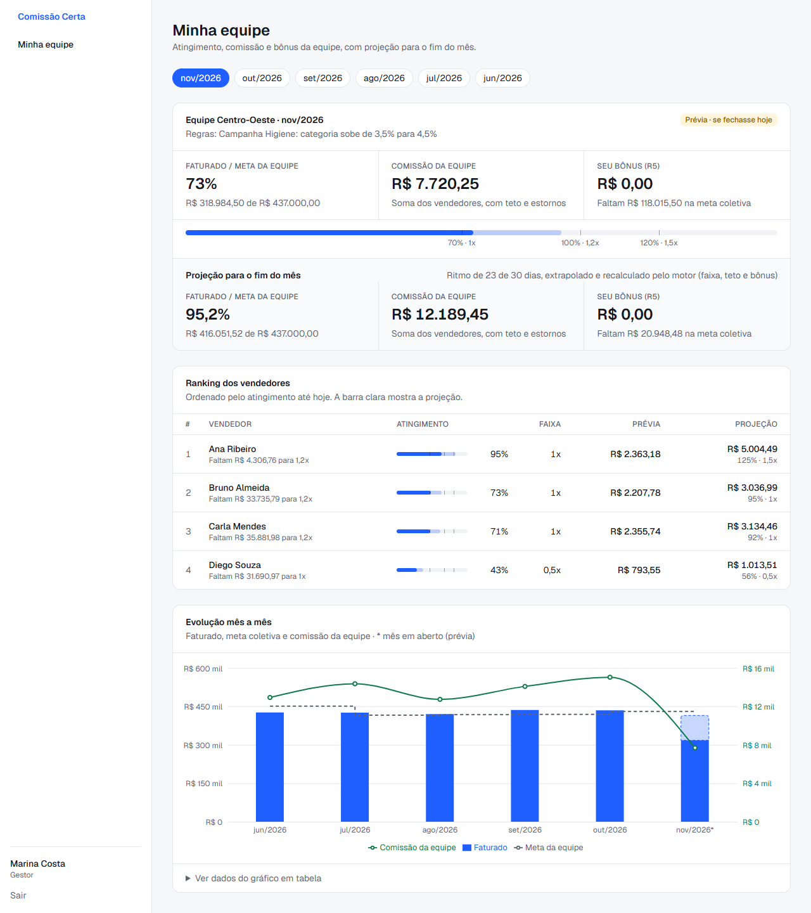
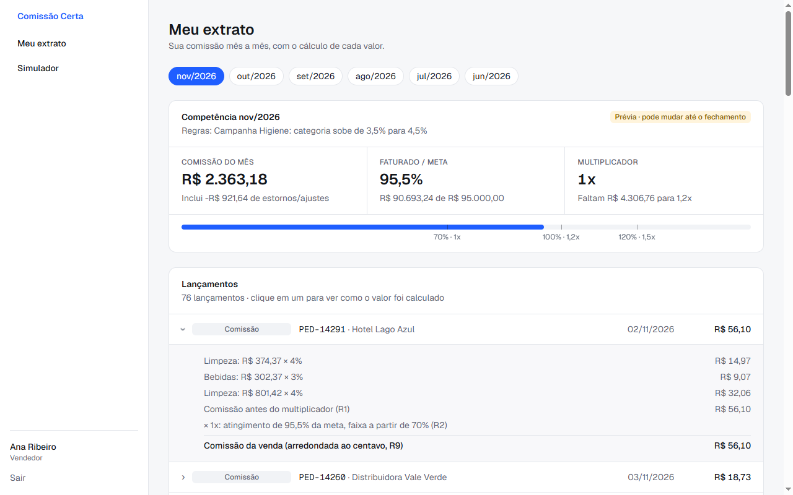
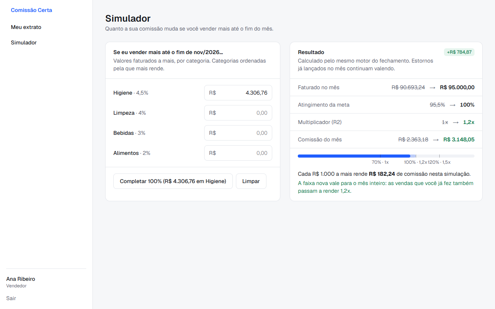
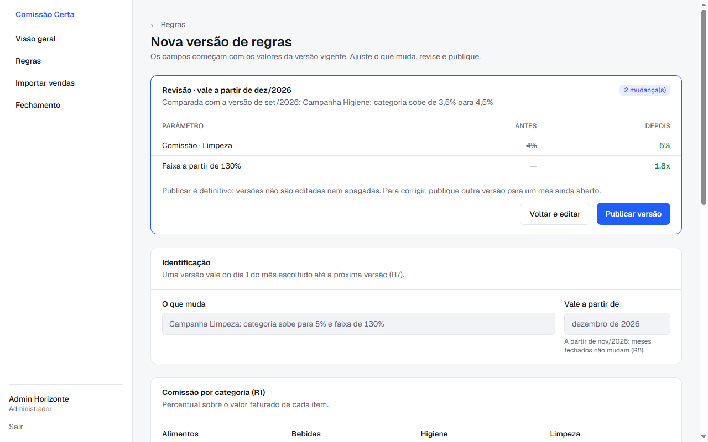
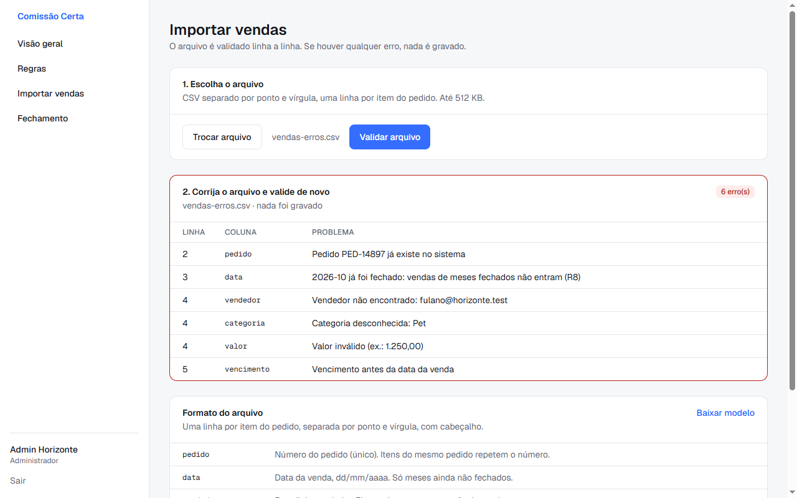
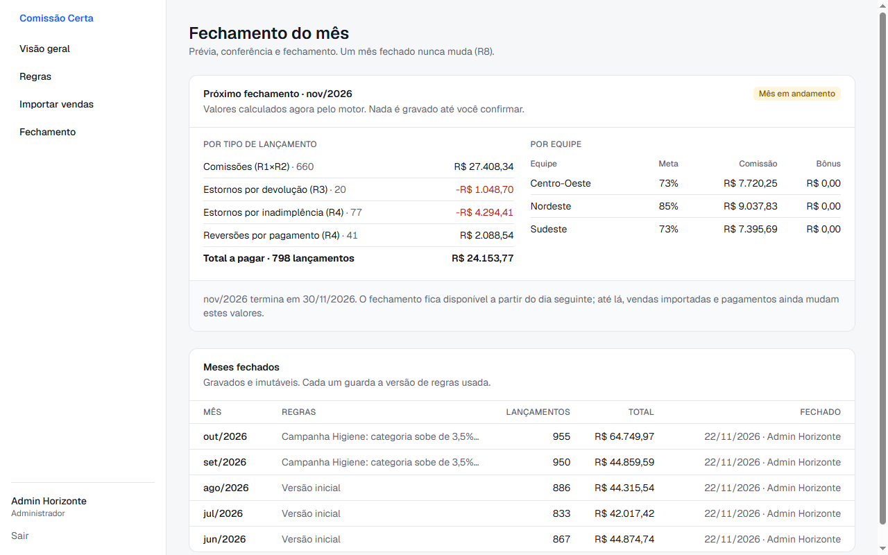

# Comissão Certa

Sistema de comissão de vendas para uma distribuidora B2B fictícia, a **Distribuidora Horizonte**. As regras de negócio ficam no centro: são versionadas, cobertas por testes e explicáveis linha a linha.

**119 testes** · **9 regras de negócio** · **3 papéis** (vendedor, gestor, admin) · Next.js 16 + PostgreSQL



## O problema

Em muitas empresas, a comissão é calculada em planilha. Faixas de meta, percentual por categoria, devoluções e clientes que não pagam viram fórmulas frágeis. Todo fim de mês alguém pergunta *"por que eu recebi esse valor?"*, e ninguém sabe responder sem abrir a planilha.

O Comissão Certa responde a essa pergunta para cada centavo. Cada lançamento guarda a **memória de cálculo**: itens, percentual, atingimento, faixa e versão das regras usada.

## As regras

| # | Regra | Parâmetros da versão inicial |
|---|---|---|
| R1 | Comissão base por categoria, sobre o valor faturado | Alimentos 2% · Bebidas 3% · Limpeza 4% · Higiene 3,5% |
| R2 | Multiplicador pelo atingimento da meta do mês | < 70% → 0,5x · 70–99% → 1x · 100–119% → 1,2x · ≥ 120% → 1,5x |
| R3 | Devolução de venda já comissionada gera estorno no mês da devolução | — |
| R4 | Título vencido há mais de 60 dias estorna a comissão; se o cliente pagar, ela volta | tolerância de 60 dias |
| R5 | Bônus do gestor quando a equipe bate a meta coletiva | 10% da comissão da equipe |
| R6 | Teto mensal por vendedor | R$ 25.000,00 |
| R7 | Regras versionadas por vigência: mudar dezembro não altera novembro | — |
| R8 | Mês fechado é imutável e auditado; correções entram no fechamento seguinte | — |
| R9 | Dinheiro em centavos inteiros e percentuais em pontos-base, arredondamento half-up por linha | — |

Os testes leem como a regra. Um trecho de [`motor.test.ts`](src/domain/commission/__tests__/motor.test.ts):

```ts
it.each([
  // faturado, meta, atingimento (bp), multiplicador (bp)
  [6_999, 10_000, 6_999, 5_000],    // 69,99% → 0,5x
  [7_000, 10_000, 7_000, 10_000],   // 70%    → 1,0x
  [10_000, 10_000, 10_000, 12_000], // 100%   → 1,2x
  [99_999, 100_000, 9_999, 10_000], // 99,999% NÃO arredonda para 100%
])("faturado %d / meta %d → %d bp → multiplicador %d bp", ...)
```

## O que cada papel vê

### Vendedor: extrato e simulador

O extrato mostra a comissão do mês, o atingimento e quanto falta para a próxima faixa. Clicando em qualquer lançamento, aparece a conta que gerou aquele valor.



O simulador responde *"e se eu vender mais R$ X em Higiene até o fim do mês?"*. Ele recalcula atingimento, faixa e comissão a cada número digitado e mostra que a faixa nova vale também para as vendas já feitas.



### Gestor: painel da equipe

Mostra o atingimento da equipe, o bônus do gestor (R5), o ranking dos vendedores e a evolução mês a mês (imagem do topo). No mês em aberto, o painel exibe duas visões:

- **Prévia:** quanto seria pago se o mês fechasse hoje.
- **Projeção:** o ritmo atual de vendas estendido até o fim do mês e recalculado pelo mesmo motor. Faixa, teto e bônus são aplicados como num fechamento de verdade.

### Admin: regras, importação e fechamento

**Regras.** Uma nova versão parte da vigente e passa por uma revisão com o diff dos parâmetros antes de ser publicada. A vigência só pode começar num mês que ainda não foi fechado.



**Importação de vendas por CSV.** O arquivo é validado linha a linha e todos os problemas aparecem num relatório só. A importação é tudo ou nada: se uma linha estiver errada, nenhuma é gravada.



**Fechamento.** O fluxo é prévia → conferência → fechar. A conferência resume o mês por tipo de lançamento e por equipe e aponta o que merece atenção, como vendedor no teto, saldo negativo ou bônus de equipe. Para fechar, é preciso digitar o nome do mês, e o botão só é liberado depois que o mês termina.



## Decisões de engenharia

**O motor é código puro.** As regras ficam em `src/domain/commission/` como funções TypeScript sem banco e sem framework. A função central recebe os dados do mês e devolve os lançamentos e os resumos:

```ts
calcularFechamento(entrada) → { linhas, vendedores, equipes, totalCentavos }
```

Isso torna o cálculo determinístico e testável com tabelas de casos. Os parâmetros de cada versão ficam no banco como JSON validado por Zod. Também considerei uma DSL genérica (json-logic) e regras em SQL, e descartei as duas: a DSL esconde a regra de negócio, e o SQL é difícil de testar e de explicar.

**Um motor só, usado em todo lugar.** Fechamento, extrato, painel do gestor, projeção e simulador chamam a mesma função:
- A **projeção** escala as vendas do mês pelo ritmo e roda o motor de novo (`projecao.ts`).
- O **simulador** acrescenta uma venda hipotética e roda o motor de novo (`simulacao.ts`).

Assim, não existe uma conta "aproximada" que diverge da conta real.

**O simulador roda no navegador, sem vazar dados.** Para responder a cada número digitado, o motor é executado no cliente. Antes, `entradaDoVendedor` recorta os dados do mês só para o vendedor logado: vendas de colegas e metas de equipe não saem do servidor. Um teste garante que o recorte produz o mesmo resultado que a entrada completa.

**Dinheiro sem float.** Valores ficam em centavos inteiros e percentuais em pontos-base (1% = 100 bp). O que o usuário digita ("25.000,00", "4,5") é convertido com aritmética de strings (`lerDecimal`). O arredondamento acontece uma única vez por linha, e 99,999% de atingimento não vira 100%.

**O passado não muda.** Um mês fechado é gravado com a versão de regras usada e não tem rota de edição. Publicar regras e importar vendas são operações validadas de novo dentro de uma transação `Serializable`. Isso impede que um fechamento concorrente deixe entrar uma venda ou uma vigência num mês que acabou de fechar. Cada uma dessas operações grava uma linha de auditoria.

**Segurança.**
- A sessão é um JWT (`jose`, HS256) num cookie httpOnly com `SameSite=Lax`.
- As senhas usam bcrypt, e o login leva o mesmo tempo para contas existentes e inexistentes.
- O `proxy` faz uma checagem rápida de rota por papel. Mesmo assim, toda página e toda Server Action confere a sessão e o papel de novo no servidor, porque uma action é um endpoint público.

## Estrutura

```
src/
  domain/commission/   motor, projeção, simulação, versões, conferência (puro + testes)
  domain/vendas/       leitura e validação do CSV (puro + testes)
  server/              acesso ao banco: fechamento, consultas, publicação, importação, auth
  app/                 rotas: login, vendedor, gestor, admin (Server Components + Actions)
  components/          UI compartilhada (barra de atingimento, gráfico, memória de cálculo)
prisma/                schema, migrações e seed da Distribuidora Horizonte
docs/design.md         design original, regras e decisões
```

## Rodar localmente

Pré-requisitos: Node 22+ e Docker.

```bash
cp .env.example .env        # gere um SESSION_SECRET novo (instrução no arquivo)
npm install
npm run db:up               # PostgreSQL 16 na porta 5434
npm run db:migrate
npm run db:seed             # ~4.900 pedidos de jun a nov/2026; jun–out já fechados
npm test                    # 119 testes
npm run dev
```

**Contas de demonstração** (senha `horizonte123`, só para uso local):

| Papel | E-mail |
|---|---|
| Admin | `admin@horizonte.test` |
| Gestora (Centro-Oeste) | `marina.costa@horizonte.test` |
| Vendedora | `ana.ribeiro@horizonte.test` |

Para testar a importação, use o modelo em [`public/modelo-vendas.csv`](public/modelo-vendas.csv), que também pode ser baixado na própria tela.

## Limitações conhecidas

- **Testes:** cobrem o domínio (motor, projeção, simulação, versões, importação). Ainda não há teste de integração do fechamento contra um banco de teste; esse caminho é exercitado pelo seed, que fecha jun–out com o mesmo serviço.
- **Rascunho de regras:** fica só no formulário e não é salvo no banco.
- **Vendas existentes:** a importação só cria vendas novas. Pagamentos e devoluções vêm do seed.
- **Escopo:** uma empresa só, sem deploy (roda localmente).

## Stack

Next.js 16 (App Router, Server Actions, Cache Components) · TypeScript · PostgreSQL 16 · Prisma 7 · Zod · Vitest · Tailwind CSS 4 · Recharts
